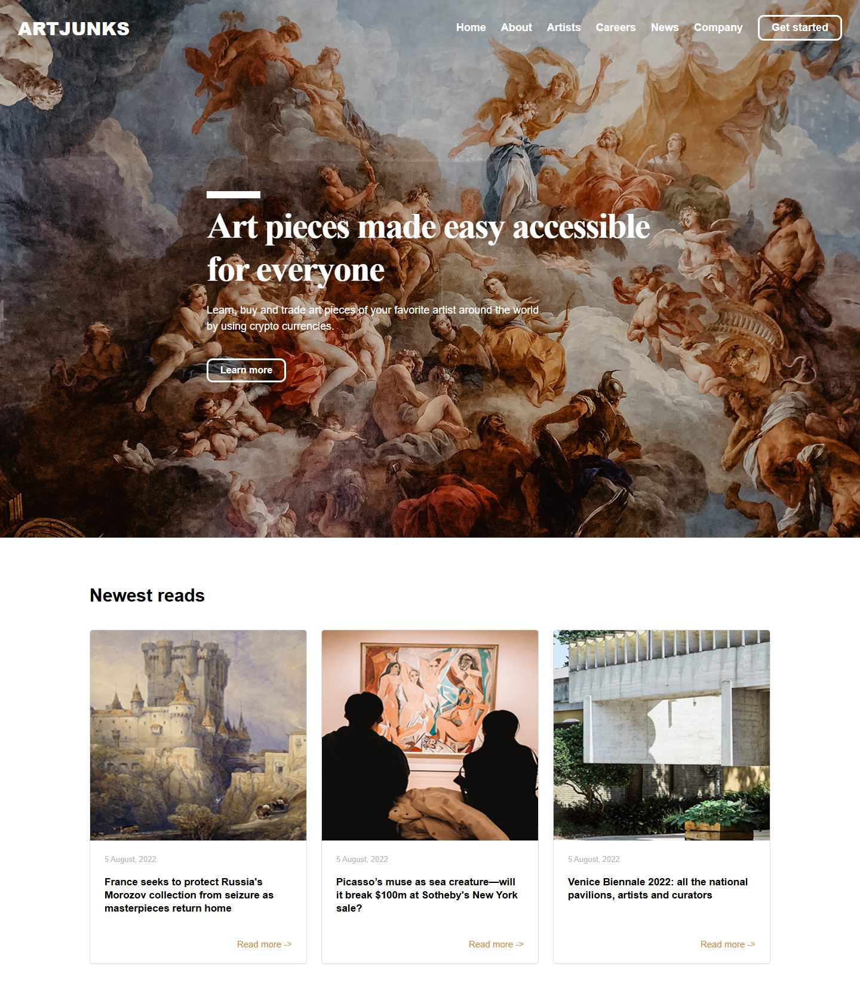
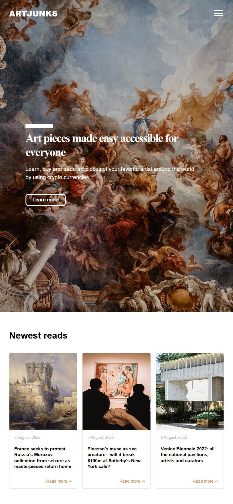
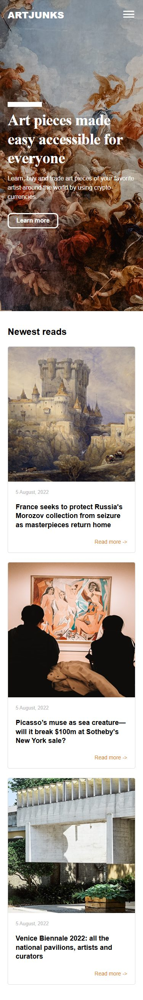
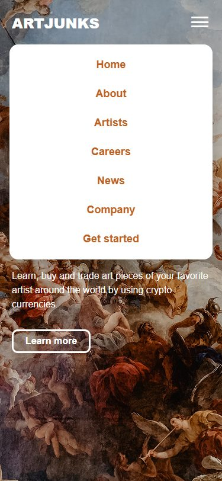
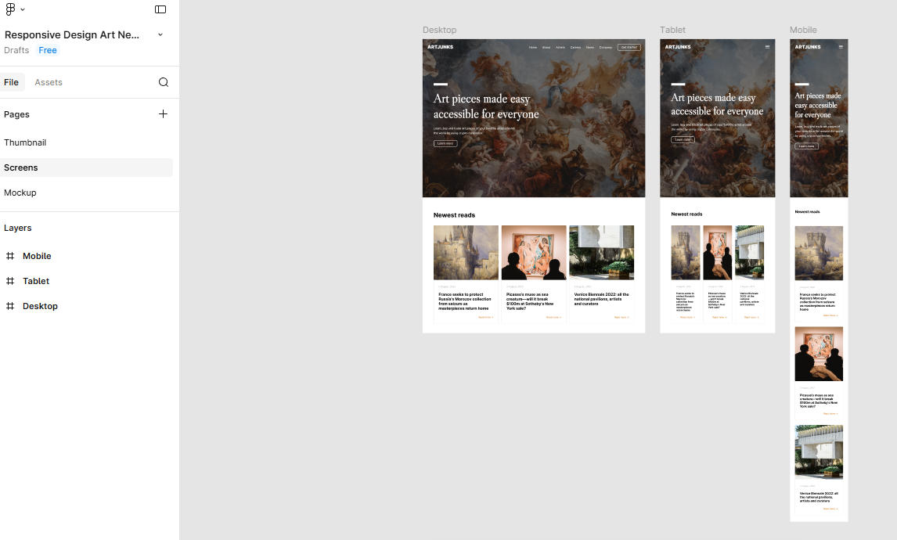

# 🎨 ARTJUNKS — Art News Landing Page

A responsive landing page for **ARTJUNKS**, a fictional platform where people can learn about, buy and trade art pieces from their favorite artists using crypto currencies. The page has a full-screen hero with a classical painting background, a navigation bar that turns into a burger menu on smaller screens, and a **"Newest reads"** section with art news cards.

Built from a Figma community design using only **HTML, CSS and vanilla JavaScript**, with no frameworks.

## 📸 Screenshots

### Desktop (1440px)


### Tablet (768px)


### Mobile (375px)
<p>
  
  &nbsp;&nbsp;
  
</p>

### Original Figma design


## ✨ Features

*   **Fully responsive**: one layout each for desktop, tablet and mobile, with no horizontal scrolling down to 320px wide.
*   **Full-screen hero**: a different background image for each screen size, with fluid headline text (`clamp()`).
*   **Burger menu**: on tablet and mobile the nav links collapse into a dropdown. It closes when you click outside it, press `Esc`, or resize back to desktop.
*   **News cards with CSS Grid**: three columns on desktop and tablet, one column on mobile. The "Read more" link always sits at the bottom of each card.
*   **No dependencies**: no Tailwind, no Bootstrap. The only external file is the [Unicons](https://iconscout.com/unicons) icon font.

## 🛠️ Tech Stack

*   **HTML5**
*   **CSS3**: Flexbox, Grid, media queries, `clamp()`, `aspect-ratio`
*   **JavaScript (vanilla)**: burger menu toggle

## 📱 Responsive Breakpoints

| Screen  | Width             | Layout                                         |
|---------|-------------------|------------------------------------------------|
| Desktop | `> 925px`         | Full nav bar, 3-column cards                   |
| Tablet  | `601px – 925px`   | Burger menu, 3-column cards                    |
| Mobile  | `≤ 600px`         | Burger menu, single-column cards               |

## 📂 Project Structure

```
├── index.html
├── css/
│   ├── component.css   # reset and shared styles
│   ├── desktop.css     # base / desktop layout
│   ├── tablet.css      # @media (max-width: 925px)
│   └── mobile.css      # @media (max-width: 600px)
├── js/
│   ├── art-mobile.js   # burger toggle and resize handling
│   └── art-toggle.js   # close menu on outside click / Esc
├── image/              # hero backgrounds and card images
└── screenshots/        # images used in this README
```

## 🚀 Getting Started

No build step is needed.

```bash
git clone https://github.com/Laurence421/Art-News-Landing-Pagee.git
cd Art-News-Landing-Pagee
```

Then open `index.html` in your browser, or use an extension like VS Code **Live Server**.

## 🎯 Credits & Inspiration

*   Layout design credit: [Responsive Design Art News Landing Page (Figma Community)](https://www.figma.com/proto/MMCrtbP0JvruWh6UZKsQJv/Responsive-Design-Art-News-Landing-Page--Community-?node-id=1-5)
*   *Note: This project is front-end cloning practice to improve my HTML, CSS and JavaScript skills.*
